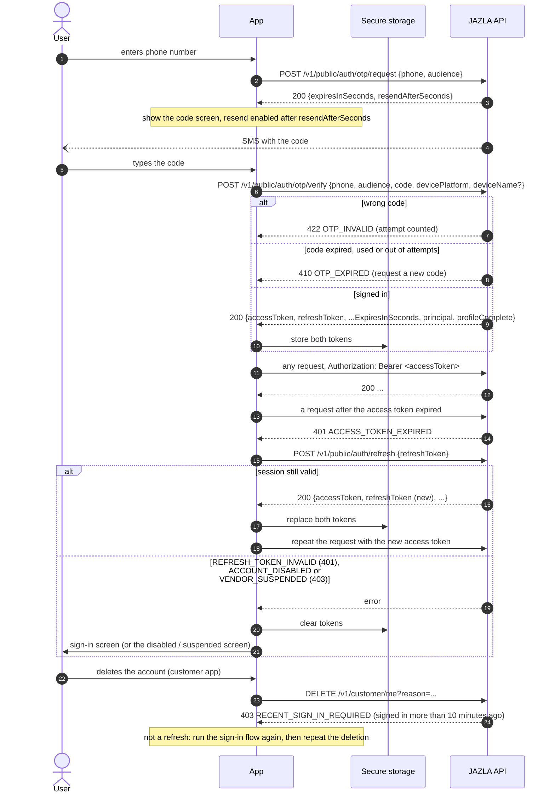

# Auth: signing in and staying signed in

A user signs in with a phone number and a code sent by SMS. There are no passwords. A successful sign-in returns two tokens:
- an **access token**, short-lived (15 minutes by default), sent on every request;
- a **refresh token**, long-lived (30 days by default), used once to get a new pair.

The lifetimes come in the response; never hard-code them.

## The audience of each app

Every sign-in names exactly one **audience**, and its tokens work only on that audience's routes (`/v1/<audience>/...`) and on `/v1/public/...`.

| App | Audience | Who can sign in |
|---|---|---|
| Flutter customer app, Next.js customer website | `customer` | any Saudi mobile number; the first sign-in creates the account |
| Vendor dashboard | `vendor` | a user with active vendor access (given when an admin approves their application) |
| Kitchen dashboard | `kitchen` | a user with active kitchen access |
| Admin dashboard | `admin` | a user with active admin access |

One person may hold several. The same phone can be a customer in the app and a vendor in the dashboard, with separate sessions.

**A staff sign-in without access fails like a wrong code.** If the phone has no active access for that audience, `POST /v1/public/auth/otp/verify` answers `OTP_INVALID` (and the request step still answers 200, so nobody can probe which numbers are staff). The dashboard should then say "this number has no access to this dashboard" next to the usual error.

## The flow



### Step by step

1. **Request a code:** `POST /v1/public/auth/otp/request` with `{ "phone": "0512345678", "audience": "customer" }`.
   - The answer is 200 with `expiresInSeconds` and `resendAfterSeconds`, whether or not the number can sign in to that audience.
   - Send `Accept-Language` so the SMS comes in the user's language.
   - A new request replaces the previous code.
   - Asking again before `resendAfterSeconds` is `RATE_LIMITED` with `Retry-After`.
2. **Verify:** `POST /v1/public/auth/otp/verify` with the same phone and audience, the `code`, `devicePlatform` (`ios`, `android` or `web`) and optionally a `deviceName` ("iPhone 16").
   - The code accepts Arabic digits and ignores spaces, so paste from the SMS works.
   - The answer holds both tokens, how long each lives, the `principal` (`userId`, masked `phone`, `audience`, `organisationId` for vendor and kitchen, `sessionId`) and `profileComplete`.
3. **Store the tokens** in secure storage:
   - Flutter: `flutter_secure_storage`.
   - Web: keep the refresh token out of reach of page scripts, for example in an HTTP-only cookie set by your Next.js server, never in `localStorage`. The API itself sets no cookies.
4. **Attach the access token** to every non-public request: `Authorization: Bearer <accessToken>`.
5. **Refresh on `ACCESS_TOKEN_EXPIRED`, and only on it.**
   - Call `POST /v1/public/auth/refresh` with `{ "refreshToken": "..." }`. Replace **both** stored tokens with the answer, and repeat the failed request once.
   - Another 401 (`UNAUTHORIZED`) means the token is unusable: sign in again; refreshing will not help.
   - You may also refresh shortly before `accessTokenExpiresInSeconds` runs out, to save a round trip.
6. **One refresh at a time.** Each refresh token works **once**. Presenting a used one ends the whole session, for safety: it means two parties hold the token. So when several requests fail with `ACCESS_TOKEN_EXPIRED` together, run a single refresh and make the others wait for its result. Never refresh in parallel, and never retry a refresh whose answer you lost; sign in again instead.
7. **The session has ended** when refresh answers `REFRESH_TOKEN_INVALID`. This happens after a sign-out, after 30 days, after the account was deleted, or after a refresh token was reused. Clear the tokens and show the sign-in screen.
   - `ACCOUNT_DISABLED` on refresh or sign-in: show the "account disabled" message.
   - `VENDOR_SUSPENDED` (vendor dashboard only): show the suspended screen.
8. **Sign out:** `POST /v1/public/auth/logout` with the refresh token. It always answers 204, so clear the tokens whatever happens.
   - Sign out on every device: `POST /v1/customer/auth/logout-all` (or `/v1/vendor/auth/logout-all`, `/v1/kitchen/auth/logout-all`, `/v1/admin/auth/logout-all`) with the access token.
9. **Who is signed in:**
   - `GET /v1/customer/me` gives the customer, their phone in full, profile and marketing consent.
   - `GET /v1/vendor/me`, `GET /v1/kitchen/me` and `GET /v1/admin/me` give the dashboards' user.

### `RECENT_SIGN_IN_REQUIRED` (403): sign in again, not a refresh

Deleting an account (`DELETE /v1/customer/me`) needs a sign-in in the last 10 minutes. A refreshed token does not count; only a new code does. On `RECENT_SIGN_IN_REQUIRED`:
1. explain why ("for your security, confirm it's you");
2. run steps 1 and 2 again for the same phone;
3. store the new tokens;
4. repeat the deletion.

It is a 403 on purpose, so a client that refreshes on 401 does not loop.

## `profileComplete` and the completion screen (customer app)

`profileComplete` in the verify answer, and in `GET /v1/customer/me`, says whether the customer has given a full name. It is `null` for vendor, kitchen and admin sign-ins.
- When it is `false`, the app may show a "complete your profile" screen right after sign-in. **The customer can skip it**: every built endpoint works without a name.
- The profile is saved with `PATCH /v1/customer/profile` (`fullName`, optional `email`, `preferredLanguage`). See [customer-profile.md](customer-profile.md).
- Placing an order will require a complete profile once orders exist (see [not-built-yet.md](not-built-yet.md)).

## Development sign-in without SMS

Locally no SMS is sent: the default SMS provider writes each message, code included, to the API's log. To sign in without reading logs, use the **review accounts** the seed sets up. Their code is fixed and no SMS is ever sent for them.

1. Run `pnpm db:seed` (see [README.md](README.md#running-the-backend-locally)). It creates one account per audience and prints, at the end, the line to add to the API's `.env`.
2. Add that line to `services/api/.env` and restart the API:

   ```bash
   AUTH_REVIEW_ACCOUNTS=+966500000001:111111,+966500000002:222222,+966500000003:333333,+966500000004:444444,+966500000005:555555
   ```

   | Audience | Phone | Code | What the account has |
   |---|---|---|---|
   | `customer` | `0500000001` | `111111` | a complete profile, three addresses, marketing consent |
   | `vendor` | `0500000002` | `222222` | owner of Al Nokhba Butchery (ملحمة النخبة), with products in every status |
   | `kitchen` | `0500000003` | `333333` | kitchen access for the platform vendor |
   | `admin` | `0500000004` | `444444` | admin access: review queues hold a pending application, products in review and a change request |
   | `customer` | `0500000005` | `555555` | no name yet, so `profileComplete` is `false` and the completion screen shows |
   | `admin`, `vendor`, `kitchen` | `0500000006` | `666666` | every staff panel: admin, vendor of Al Nokhba Butchery, kitchen of the platform vendor (staging review) |

   The codes assume the default code length of 6 digits (`AUTH_OTP_LENGTH`). The seed prints the line for the length your `.env` sets.

3. Sign in as usual: request a code for the phone and audience, then verify with the fixed code.

Review accounts exist for app-store reviewers and for development only. **Never put these numbers in a staging or production configuration.** The production review accounts, if any, are decided by the backend team.
