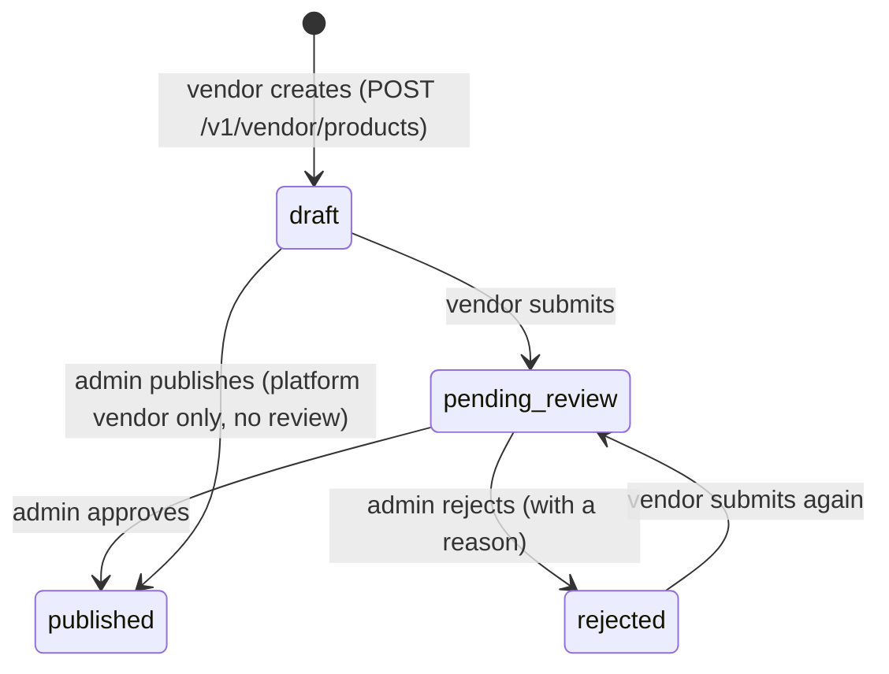

# Catalog: browsing, the vendor's products, the admin's catalog

## The pieces

| Piece | What it is | Who manages it |
|---|---|---|
| **Reference lists** | `categories` (ordered by `sortOrder`), `meat-types`, `cutting-styles`, `exclusion-items` (the "without" items: الرأس، الكرشة). Each entry has an `{ ar, en }` name and `isActive`. Entries are never deleted, only switched off. | admin |
| **Incompatibilities** | Pairs of a cutting style and a packaging that a customer may not choose together. A product may offer both; the pair is refused at the cart | admin |
| **Product** | Belongs to one vendor. Holds: <ul><li>name and description;</li><li>category and an optional meat type;</li><li>up to 10 images (the first is the cover);</li><li>up to 20 **sizes**, each with an approximate weight in grams, a price in halalas, an optional `tag` and its own availability;</li><li>up to 30 **cutting styles**, each with an extra price;</li><li>**packagings** (`trays`, `bags`, `vacuum`, `none`), each with an extra price;</li><li>"without" items;</li><li>**fulfilment** (`delivery`, `pickup`, `both`);</li><li>**availability** (`isAvailable`).</li></ul> | vendor (reviewed by admins), or admin for the platform vendor's products |
| **Change request** | A vendor's edit of a published product, waiting for an admin | vendor proposes, admin decides |

All prices are **integer halalas with VAT included** (see [conventions.md](conventions.md#money-integer-halalas)). A product's `minPriceHalalas` is its lowest size price, the "from" price on cards.

## Product statuses

| Status | Who sees it | What the vendor can do |
|---|---|---|
| `draft` | the vendor and admins | edit freely; submit |
| `pending_review` | the vendor and admins | **nothing**: every edit is `PRODUCT_NOT_EDITABLE` until an admin decides |
| `rejected` | the vendor (with `rejectionReason`) and admins | edit freely; submit again |
| `published` | customers, when also available, of an active vendor, in an active category | content edits become change requests; availability, fulfilment and prices apply at once |

## What applies at once, and what goes to review

| Vendor action | `draft` / `rejected` | `published` | `pending_review` |
|---|---|---|---|
| Content: `PUT /v1/vendor/products/{id}` | saved at once | **becomes a change request** for review; the live product does not change | refused |
| Availability: `PATCH /v1/vendor/products/{id}/availability` | at once | **at once**, no review | refused |
| Fulfilment: `PATCH /v1/vendor/products/{id}/fulfilment` | at once | **at once**, no review | refused |
| Prices: `PATCH /v1/vendor/products/{id}/prices` | at once | **at once**, no review (recorded in the audit log) | refused |

"Refused" means `PRODUCT_NOT_EDITABLE`, with `details.status`.

The platform vendor's products (JAZLA's own) are edited by admins, and **everything applies at once**, published or not, with no change requests (`PUT /v1/admin/products/{id}` and the admin `PATCH` endpoints).

## Change requests

When a vendor edits a published product, the edit becomes a change request.

```mermaid
stateDiagram-v2
    [*] --> pending: vendor edits a published product
    pending --> approved: admin approves (its content becomes the live product)
    pending --> rejected: admin rejects (with a reason; the live product stays)
    pending --> superseded: vendor edits again before a decision
```

- A product has **at most one pending request**. A new edit closes the pending one as `superseded` and creates a new one.
- A request's content **never changes** after it is created.
- The vendor sees the latest request (pending or decided) in the product's `changeRequest`. `null` means there has never been one.
- **Prices are not part of the review.** On approval, sizes, cutting styles and packagings the product already has keep their live prices; new ones take the prices in the request. A pending request is not touched by price changes.
- **Admin, `PRODUCT_CHANGE_REQUEST_SUPERSEDED` on approve or reject:** the vendor edited again. Reload the queue: the newer request is there.

## Customer app and website: browsing

No token is needed for any of these.
1. **Home and category menu:** `GET /v1/public/categories`.
   - It returns every active category in `sortOrder`, each with `imageUrl` (`null` when the category has no image).
   - It is **not paged**.
2. **Product lists:** `GET /v1/public/products`. It is paged, newest first, and has optional filters that combine:
   - `categoryId`, `vendorId`, `meatTypeId`;
   - `minPriceHalalas`, `maxPriceHalalas`, on the lowest size price, both ends included;
   - `q`, text search on the product name in Arabic or English: 2 to 100 characters after trimming. It ignores Arabic diacritics and tatweel, reads أ إ آ as ا, ى as ي and ة as ه, and ignores English case, so `لحم غنم` finds `لَحْم غَنَم` and `ذبيحه` finds `ذبيحة`. `%` and `_` match themselves. No match is an empty page, not an error.

   Only products a customer can buy appear: published, available, of an active vendor, in an active category. An unknown filter id finds nothing; it is not an error. Each card has `name`, `vendor`, `minPriceHalalas` and `coverUrl`.
3. **Product page:** `GET /v1/public/products/{id}`. It returns everything a customer chooses from:
   - `isAvailable`: `false` when the product is switched off (out of stock). Show the page with the out-of-stock notice and nothing to add;
   - `sizes`: `id`, weight, price, an optional `tag` such as "يكفي لعقيقة", and `isAvailable` (a size switched off is shown disabled);
   - `defaultSizeId`: the size to select when the page opens (the first available one), null when none is available;
   - `cuttings`: name and extra price. With any cutting, the customer must choose one (`OPTION_REQUIRED`);
   - `packagings`: `[{ packaging, extraPriceHalalas }]`;
   - `exclusions`;
   - `incompatiblePairs`: `[{ cuttingStyleId, packaging }]`, the pairs among this product's options that may not be chosen together. Disable the packaging once its cutting is chosen (and the other way round); the cart refuses the pair with `INCOMPATIBLE_CUTTING_PACKAGING`;
   - `fulfilment`.

   `NOT_FOUND` means the product is no longer for sale (not published, vendor suspended, category off): show "no longer available". A product switched off is still returned, with `isAvailable: false`, but it is left out of the lists.
4. **A store's products:** `GET /v1/public/products?vendorId=<id>`, next to `GET /v1/public/vendors/{id}`.

Adding to a cart is not built yet (see [not-built-yet.md](not-built-yet.md)).

## Vendor dashboard: products

**List:** `GET /v1/vendor/products`, optionally with `?status=draft|pending_review|published|rejected`. It is paged. A pending change request does not show on the card: open the product to see it.

**New product:**
1. Upload each image with purpose `catalog.product-image` (JPEG, PNG or WebP, up to 5 MiB), and confirm each one (see [uploads.md](uploads.md)).
2. `POST /v1/vendor/products` with:
   - `name`, and optionally `description`;
   - `categoryId`, and optionally `meatTypeId`;
   - `imageMediaIds`, in display order;
   - `sizes`: `[{ approxWeightGrams, priceHalalas, tag? }]`;
   - `cuttings`: `[{ cuttingStyleId, extraPriceHalalas }]`;
   - `packagings`: `[{ packaging, extraPriceHalalas }]`, each packaging once, `0` for no extra charge;
   - `exclusionItemIds`, `fulfilment`.

   > **Changed in #243:** `packagings` used to be a list of names (`["trays"]`). It is now a list of objects in requests and in every response, like `cuttings`. Regenerate your client.

   The result is a `draft`, available. A draft may be incomplete.
3. **Submit:** `POST /v1/vendor/products/{id}/submit`. It needs at least one size and one image. Otherwise the answer is `PRODUCT_NOT_SUBMITTABLE`, and `details.reasons` lists `NO_SIZE` and `NO_IMAGE`. The incompatibility rules never block a submission: they limit what customers may choose together.

   Show all of them at once.

**Edit content:** `PUT /v1/vendor/products/{id}` **replaces the whole content**. Send every field, with lists in display order.
- **Keep an existing size by sending its `id`.** A size left out is removed; a size without `id` is new.
- **Existing sizes, cutting styles and packagings must carry their current price.** A changed price there is `VALIDATION_FAILED` (`isLivePrice`). Change prices with the prices endpoint.
- **On a published product,** the answer's `changeRequest` is the new pending request; the live content is unchanged. Show "your changes are waiting for review".

**Prices:** `PATCH /v1/vendor/products/{id}/prices` with:
- `sizes: [{ sizeId, priceHalalas }]`;
- `cuttings: [{ cuttingStyleId, extraPriceHalalas }]`;
- `packagings: [{ packaging, extraPriceHalalas }]`.

Only the entries sent change. Each must be one the product offers (`isSizeOfProduct`, `isCuttingOfProduct`, `isPackagingOfProduct`).

**Availability:** `PATCH /v1/vendor/products/{id}/availability` with `{ "isAvailable": false }`. It is the "out of stock" switch: the product leaves the public lists at once (its page shows it out of stock), and comes back when switched on. Add `"sizes": [{ "sizeId": "…", "isAvailable": false }]` to switch single sizes; the others keep theirs, and a new size starts available. A size not of the product, or named twice, is `VALIDATION_FAILED` (`isSizeOfProduct`, `isNotRepeated`).

**Fulfilment:** `PATCH /v1/vendor/products/{id}/fulfilment` with `{ "fulfilment": "delivery" | "pickup" | "both" }`.

**Product form errors:**

| Code | Meaning |
|---|---|
| `VALIDATION_FAILED` | The constraint names say why: `isActiveCategory`, `isActiveMeatType`, `isActiveCuttingStyle`, `isActiveExclusionItem` (an entry that is off or unknown), `isNotRepeated`, `isSizeOfProduct`, `isCuttingOfProduct`, `isPackagingOfProduct`, `isLivePrice`. |
| `MEDIA_NOT_FOUND` / `MEDIA_NOT_READY` | `details.mediaId` names the image: not uploaded by this user, or not confirmed. |
| `NOT_FOUND` | An unknown product, or another vendor's product. Both answer the same. |

**The form's pickers:**
- Categories: `GET /v1/public/categories`.
- Meat types, cutting styles and "without" items: `GET /v1/vendor/lists/{list}` with `meat-types`, `cutting-styles` or `exclusion-items`. Active entries only, with both names, **not paged**, oldest first.
- Incompatible pairs: `GET /v1/vendor/cutting-packaging-incompatibilities`, the pairs of active cutting styles with the cutting style's name, not paged. Use them to show which pairs customers will not be able to choose.

The admin list endpoints stay admin-only: a vendor token there is `FORBIDDEN`.

## Admin dashboard: catalog settings

**Lists:** `{list}` is one of `categories`, `meat-types`, `cutting-styles` or `exclusion-items`.

| Action | Endpoint and rules |
|---|---|
| List | `GET /v1/admin/lists/{list}`, optionally with `?isActive=true` or `?isActive=false`. Paged, newest first. The public order of categories is their `sortOrder`, not this order. |
| Add | `POST /v1/admin/lists/{list}` with `{ name: { ar, en }, sortOrder?, imageMediaId? }`. `sortOrder` and `imageMediaId` are for categories only; on another list they are `VALIDATION_FAILED` (`isOrderedList`, `isCategoryList`). A new entry is active. |
| Change | `PATCH /v1/admin/lists/{list}/{id}` with `name`, `isActive` and (categories) `sortOrder` and `imageMediaId` (`null` removes the image). It applies at once. **Switching off** an entry stops vendors from choosing it, while products already using it keep it. Switching off a **category** also hides all its products from the public catalog until it is switched on again. |

**Category image:** upload with purpose `catalog.category-image` (JPEG, PNG or WebP, up to 2 MiB) through `POST /v1/admin/media/uploads`, confirm it, then send its id as `imageMediaId`. `MEDIA_NOT_FOUND` / `MEDIA_NOT_READY` as for product images. Categories answer with `imageUrl`.

**Incompatibilities:**

| Action | Endpoint and rules |
|---|---|
| List | `GET /v1/admin/cutting-packaging-incompatibilities` (by id; the names come from the cutting styles list) |
| Add | `POST /v1/admin/cutting-packaging-incompatibilities` with `{ cuttingStyleId, packaging }`. `CONFLICT` when the rule exists already. Products keep their options; from now on customers cannot choose the pair on any product (it appears in the product's `incompatiblePairs`). |
| Remove | `DELETE /v1/admin/cutting-packaging-incompatibilities/{id}` |

## Admin dashboard: products and review

**All products:** `GET /v1/admin/products`, with optional `status` and `vendorId`. It is paged.

**One product:** `GET /v1/admin/products/{id}`. It includes the latest change request: compare the live product with `changeRequest`.

**Review queue of new products:** `GET /v1/admin/products?status=pending_review`.
- **Approve:** `POST /v1/admin/products/{id}/approve`. The product becomes `published`.
- **Reject:** `POST /v1/admin/products/{id}/reject` with `{ "reason": "..." }`. The vendor reads the reason as `rejectionReason`.
- `PRODUCT_NOT_EDITABLE`: another admin decided first. Reload.

**Review queue of edits:** `GET /v1/admin/product-change-requests`. It lists pending requests only, paged, each with the proposed content.
- **Approve:** `POST /v1/admin/product-change-requests/{id}/approve`. The request's content becomes the live product.
- **Reject:** `POST /v1/admin/product-change-requests/{id}/reject` with `{ "reason": "..." }`. It answers 204.
- `PRODUCT_CHANGE_REQUEST_SUPERSEDED`: reload the queue.
- `NOT_FOUND`: the request is unknown or already decided.

**JAZLA's own products** (the platform vendor; no review):

| Action | Endpoint |
|---|---|
| Create a draft | `POST /v1/admin/products` (same body as the vendor's; upload images as the admin) |
| Edit | `PUT /v1/admin/products/{id}`: at once, even when published |
| Publish | `POST /v1/admin/products/{id}/publish`: a draft goes straight to `published` (same submission rules) |
| Availability | `PATCH /v1/admin/products/{id}/availability` |
| Fulfilment | `PATCH /v1/admin/products/{id}/fulfilment` |
| Prices | `PATCH /v1/admin/products/{id}/prices` |

- These answer `NOT_FOUND` for another vendor's product: admins act on vendors' products only through review.
- `NOT_FOUND` with `details.reason: "PLATFORM_VENDOR_MISSING"` means the platform vendor has not been set up. Locally, `pnpm db:seed` sets it up.
