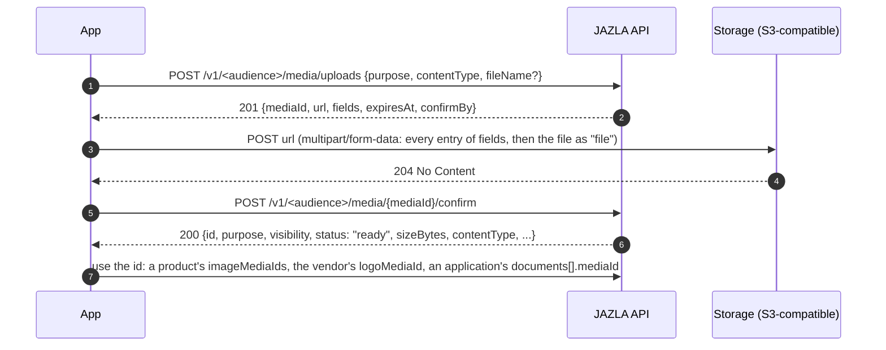

# Uploads: images and documents

Files never pass through the API. The app asks the API for an upload ticket, sends the file **straight to storage** with the ticket, then asks the API to confirm it. Only a confirmed file can be used, and only by the user who uploaded it.

## The three steps



1. **Request a ticket:** `POST /v1/vendor/media/uploads` (or the `customer` or `admin` one; see the table below) with:
   - `purpose`;
   - `contentType`, the file's MIME type, for example `image/jpeg`;
   - optionally `fileName`, the name on the device, for display only.

   The answer holds:
   - `mediaId`;
   - `url`, the storage address;
   - `fields`, the form fields;
   - `expiresAt`, until when the storage accepts the upload (5 minutes by default);
   - `confirmBy`, until when the API accepts the confirmation (1 hour by default).
2. **Upload to storage:** `POST` to `url` as `multipart/form-data`.
   - First add **one text part for every entry of `fields`**, name and value exactly as given: add none and change none.
   - Then add **the file as the last part, named `file`**.
   - Send **no** `Authorization` header: this is the storage, not the API.
   - The storage answers **204** with no body. Its errors are 4xx with an XML body, not the API's error format; treat any non-204 as "upload failed".
   - Until `expiresAt`, the same ticket can be reused after a network failure; the last upload wins.
3. **Confirm:** `POST /v1/vendor/media/{id}/confirm` (same audience; `{id}` is the `mediaId`), **only after the storage answered 204**, and before `confirmBy`.
   - The API checks that the file exists, is not empty, is within the size limit, and that its real type (read from its first bytes) is one the purpose accepts and equals the declared `contentType`.
   - The answer is the file, `status: "ready"`. Confirming again returns it again.
4. **Use the id** in the endpoint that takes the file: a product's `imageMediaIds`, the vendor's `logoMediaId`, or a vendor application's `documents[].mediaId`. A file that is not confirmed yet is refused there with `MEDIA_NOT_READY`.

Read `expiresAt` and `confirmBy` from the response: they are server settings.

### Flutter (Dio)

```dart
final ticket = await mediaApi.vendorRequestMediaUpload(/* purpose, contentType, fileName */);
final form = FormData.fromMap({
  ...ticket.fields,                     // every field, unchanged, first
  'file': await MultipartFile.fromFile(path, contentType: MediaType.parse(contentType)),
});
await Dio().post(ticket.url, data: form); // a plain Dio: no auth interceptor here
await mediaApi.vendorConfirmMediaUpload(id: ticket.mediaId);
```

### Browser (fetch)

```ts
const form = new FormData();
for (const [name, value] of Object.entries(ticket.fields)) form.append(name, value);
form.append('file', file); // last
const res = await fetch(ticket.url, { method: 'POST', body: form }); // no Authorization header
if (res.status !== 204) throw new Error('upload failed');
```

The storage must accept the browser's origin (CORS on the bucket). Locally, MinIO allows it. If an upload from the dashboard fails with a CORS error on a deployed environment, report it to the backend team.

## Purposes per audience

| Purpose | Who uploads it (endpoint) | Types | Max size | Visibility | Used in |
|---|---|---|---|---|---|
| `vendor.document` | customer (`POST /v1/customer/media/uploads`) | `application/pdf`, `image/jpeg`, `image/png` | 10 MiB | private | a vendor application's `documents[].mediaId` |
| `vendor.logo` | vendor (`POST /v1/vendor/media/uploads`), admin (`POST /v1/admin/media/uploads`) | `image/jpeg`, `image/png`, `image/webp` | 2 MiB | public | the vendor profile's `logoMediaId` |
| `catalog.product-image` | vendor, admin | `image/jpeg`, `image/png`, `image/webp` | 5 MiB | public | a product's `imageMediaIds` |

- A purpose not listed for the audience is `VALIDATION_FAILED`.
- **Public** files have a stable URL, returned by the endpoints that show them (`logoUrl`, a product's `images[].url`).
- **Private** files (application documents) are read only through short-lived links the API gives to admins (see [vendors.md](vendors.md)).

Check the type and the size in the app before requesting a ticket, so the user hears about it before uploading. Compress large photos on the device: 5 MiB is a ceiling, not a target.

## Limits

| Limit | Count |
|---|---|
| Ticket requests per client address | 30 a minute |
| Ticket requests per user | 100 an hour |
| Confirmations per client address | 60 a minute |

Over a limit, the answer is `RATE_LIMITED` with `Retry-After`. While the limits cannot be counted, uploads are refused with `SERVICE_UNAVAILABLE` instead of going through unlimited.

## Errors

| Code | When | Do |
|---|---|---|
| `MEDIA_CONTENT_TYPE_NOT_ALLOWED` (415) | ticket: the purpose does not accept `contentType` (`details.allowed` lists what it does) | tell the user the file type is not accepted |
| `VALIDATION_FAILED` (400) | ticket: a purpose this app may not upload, a missing or too long `contentType` or `fileName`; confirm: the id is not a UUID | bug in the app |
| `MEDIA_NOT_FOUND` (404) | confirm: unknown id, another user's file, or an unconfirmed upload already removed | start again from step 1 |
| `MEDIA_UPLOAD_EXPIRED` (410) | confirm: `confirmBy` has passed | start again from step 1 |
| `MEDIA_UPLOAD_REJECTED` (422) | confirm: the file failed a check and was deleted. `details.reason` is one of: `OBJECT_MISSING` (nothing uploaded: confirm only after the 204), `EMPTY_FILE`, `TOO_LARGE`, `TYPE_NOT_ALLOWED`, `CONTENT_TYPE_MISMATCH` (for example a PNG declared as `image/jpeg`: send the file's real type), `OWNER_DELETED` (the account was deleted) | ask for another file and start again from step 1 |
| `MEDIA_NOT_READY` (409) | using an id that was not confirmed (or was rejected) | confirm first |
| `RATE_LIMITED` (429), `SERVICE_UNAVAILABLE` (503) | see above | wait or retry |

The ticket and confirm endpoints also return the usual authentication codes of their audience (see [errors.md](errors.md)).

An upload that is never confirmed is removed automatically after `confirmBy`. There is nothing to clean up on the client.
